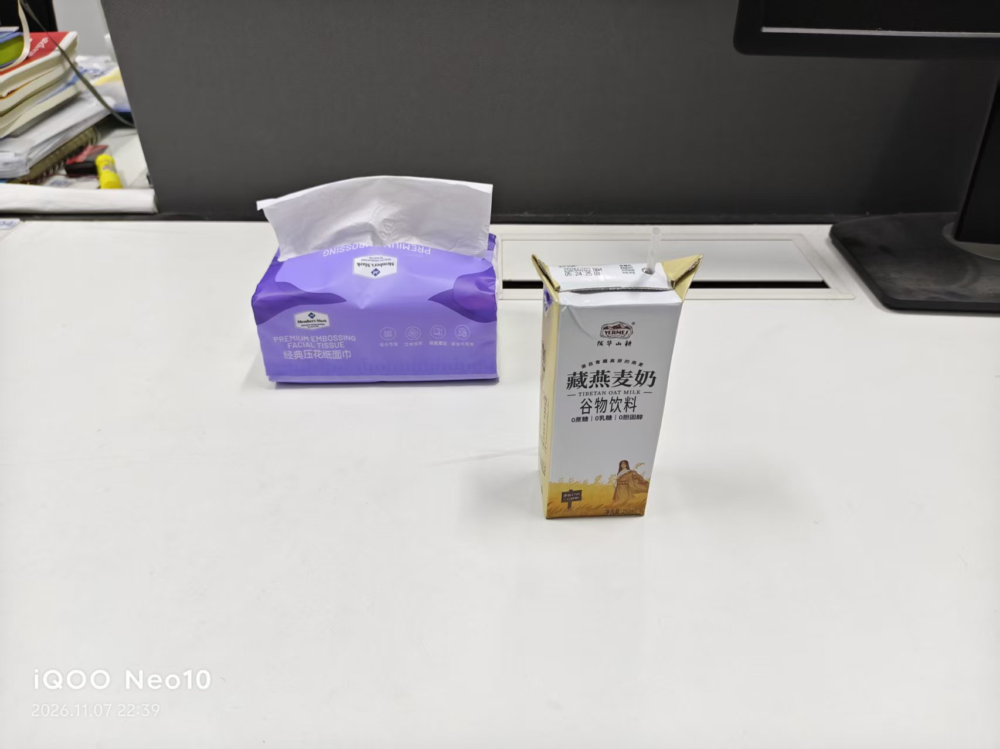
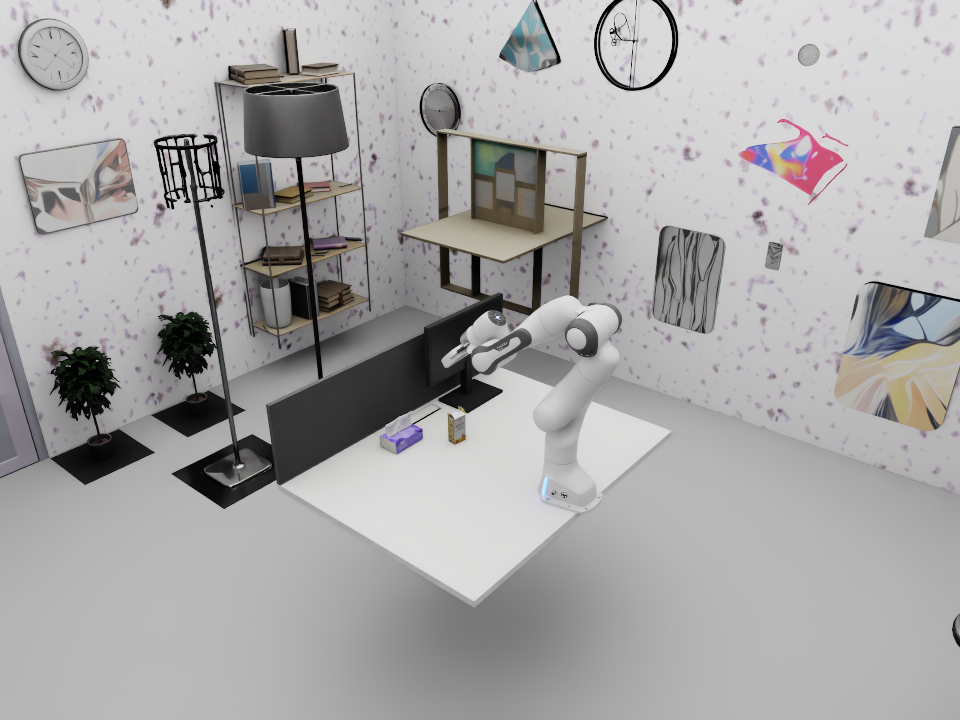
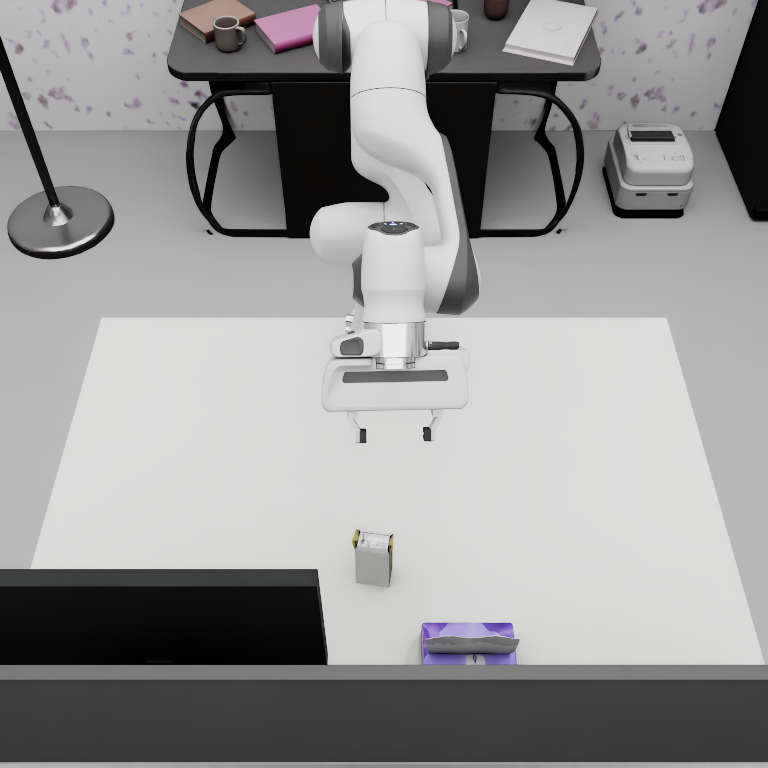
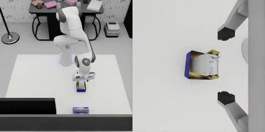

  
  <h1>EvoWorld</h1>
  
<strong>From photo-based scenes to simulation policy learning</strong>

  
<a href="README.md">中文</a> · English

  
<a href="#pipeline">Pipeline</a> · <a href="#scenes-and-task">Scenes and task</a> · <a href="#task-evaluation">Evaluation</a> · <a href="#documentation">Documentation</a>

EvoWorld connects **GPT-assisted modeling, SAGE expert demonstrations and RLinf policy learning**: construct simulation scenes from photos and task descriptions, collect demonstrations, convert datasets, and conduct SFT, reinforcement learning and independent evaluation.

This personal integration project focuses on scene adapters, demonstration-to-dataset conversion, observation/action conventions and cross-component configuration and dispatch.

## Pipeline

| Stage | Foundation | Integration |
| --- | --- | --- |
| Photo modeling | GPT-assisted scene and asset generation | Inputs, generated programs and build-feedback iterations |
| Simulation | USD / Isaac | Scene assets, cameras and task configuration |
| Demonstrations | SAGE, M2T2, cuRobo | Connect grasping and planning to the target scene |
| Dataset bridge | HDF5 / LeRobot | Timing, action conversion, validity and training-set normalization |
| Policy learning | RLinf, π₀.₅, DSRL | SFT/RL dispatch and independent online evaluation |

The launcher connects existing implementations rather than replacing their algorithms. Both current SFT and RL entry points use RLinf. See the [source-grounded layout notes](docs/presentation/pipeline-layout.md).

## Scenes and task

### Photo-based scene construction

<table>
<tr><th>Input photograph</th><th>Generated scene preview</th></tr>
<tr><td></td><td></td></tr>
</table>

These historical modeling assets illustrate scene construction; they are not frame-paired side70 policy-evaluation results. Preview cameras and evaluation observation versions are recorded separately.

### Franka: place oat milk into a storage bin

<table>
<tr><th>Historical modeled scene: tabletop view</th><th>Final frame of a successful DSRL episode</th></tr>
<tr><td></td><td></td></tr>
</table>

[Watch the successful seed-20000 episode →](media/episode-000.mp4). This is a selected successful example, not the aggregate result. See [asset provenance](docs/presentation/evidence.md) and the evaluation below.

## Task evaluation

`milk-bin-side70-v1`, one simulated task, 20 fixed evaluation seeds (20000–20019). Predict 20 actions and execute 10 before replanning, with a 1000-control-step limit, 10 denoising steps and the same physical success thresholds.

| Policy | Successful episodes | Sample success rate |
| --- | --- | --- |
| π₀.₅ SFT, 20,000 updates | 4 / 20 | 20% |
| SFT followed by DSRL, final iteration 290 | 9 / 20 | 45% |

An increase of **25 percentage points** in this sample. These are archived results completed on November 10, 2026; no evaluation was rerun for this presentation. Success requires containment, support, release and stability.

This small same-task simulation comparison does not establish real-robot performance or broad generalization. DSRL uses a deterministic noise actor while SFT uses native seeded decoder noise, so it does not isolate training effects from noise-selection effects. DSRL also takes more steps on the three seeds where both policies succeed. See the [original comparison](docs/presentation/comparison.json), [per-episode DSRL report](docs/presentation/report.json) and [full experiment notes](docs/SIDE70_PIPELINE.md).

## Entry points

| Command | Purpose |
| --- | --- |
| `generate` | GPT-assisted scene/asset generation |
| `collect` | Expert demonstration collection |
| `convert` | Training-dataset conversion |
| `sft` | RLinf supervised fine-tuning |
| `rl` | RLinf reinforcement learning |
| `eval` | Independent policy evaluation |

Dispatch with `python -m evoworld <command>`; consult the usage guide for arguments and external resources. `doctor` checks prerequisites and `--dry-run` previews commands; neither establishes simulation or training acceptance.

## Documentation

| Topic | Guides |
| --- | --- |
| Setup and usage | [Complete usage guide](docs/usage-guide.en.md) · [Machine template](configs/local.example.yaml) |
| Environments and resources | [Environment preparation](docs/ENVIRONMENTS.en.md) · [Resources](docs/RESOURCES.en.md) · [Workspace layout](docs/WORKSPACE.md) |
| Scene and expert collection | [Expert environment](docs/P6000_EXPERT.md) · [Task adapters](adapters/milk_bin) |
| Data, training and evaluation | [Complete side70 pipeline](docs/SIDE70_PIPELINE.md) · [RL research module](research/rl/README.md) |
| Migration and compatibility | [Acceptance](docs/ACCEPTANCE.en.md) · [Upstream versions](manifests/upstreams.json) |
| Presentation evidence | [Pipeline notes](docs/presentation/pipeline-layout.md) · [Assets and results](docs/presentation/evidence.md) |

Both previous READMEs are preserved as usage guides. The old English side70 candidate statement is marked as historical; the current formal observation contract is `milk-bin-side70-v1`. Complete datasets, weights, environments and machine profiles remain external resources.

## Acknowledgements

Thanks to SAGE, RLinf, OpenPI / π₀.₅, M2T2, cuRobo and Isaac. Exact sources, versions and patches are recorded in [manifests/upstreams.json](manifests/upstreams.json), with licenses under [third_party_licenses](third_party_licenses). RLinf is managed as a [fork](https://github.com/Galahad1123/RLinf) submodule. No blanket license is granted for third-party contents.
