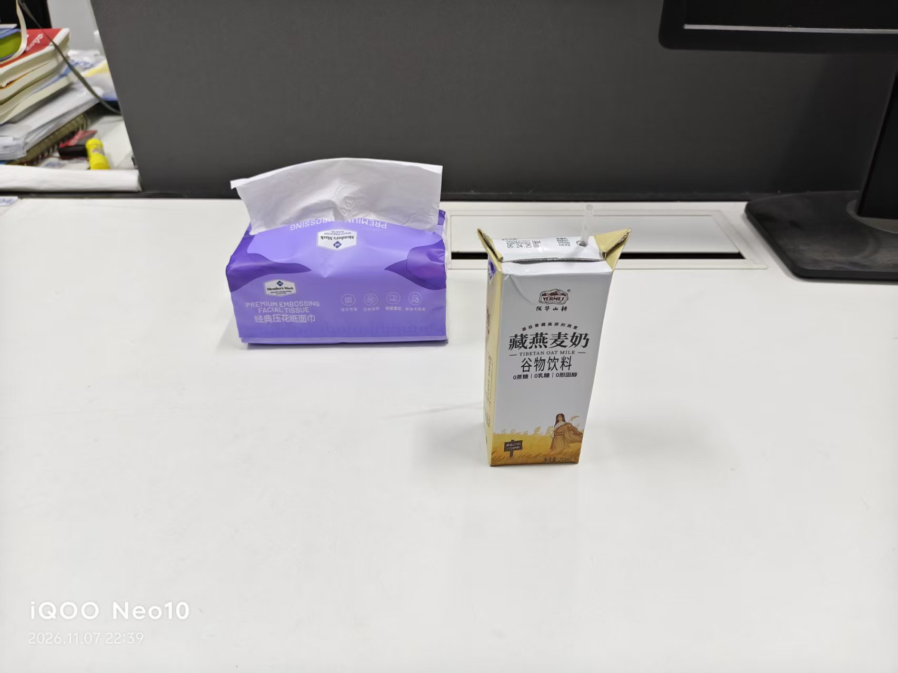
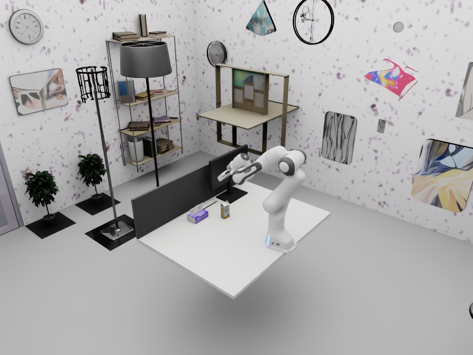
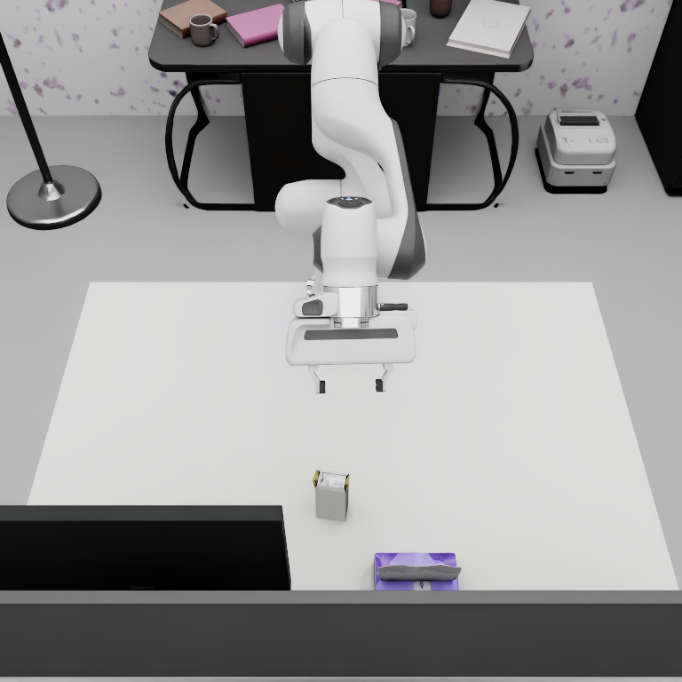
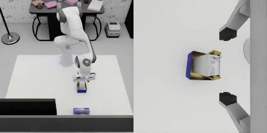

  
  <h1>EvoWorld</h1>
  
<strong>从照片场景构建到仿真策略学习</strong>

  
中文 · <a href="README.en.md">English</a>

  
<a href="#流水线概览">流水线</a> · <a href="#场景与任务">场景与任务</a> · <a href="#任务评测">任务评测</a> · <a href="#文档导航">文档导航</a>

EvoWorld 将 **GPT 辅助快速建模、SAGE 专家示范生成和 RLinf 策略训练**连接为一条机器人学习流水线：从照片与任务出发构建仿真场景，采集专家轨迹，转换训练数据，再开展 SFT、强化学习与独立评测。

这是一个个人系统集成与探索项目。工作重点在于场景适配、示范到数据集的转换、观测与动作约定，以及跨组件的配置和调度。

## 流水线概览

| 环节 | 上游基础 | 本项目连接内容 |
| --- | --- | --- |
| 照片建模 | GPT 辅助场景与资产生成 | 组织输入、生成程序以及构建反馈迭代 |
| 场景与仿真 | USD / Isaac | 场景资产、相机和任务运行配置 |
| 专家示范 | SAGE、M2T2、cuRobo | 将抓取与规划流程接入目标场景，采集示范 |
| 数据转换 | HDF5 / LeRobot | 时序对齐、动作转换、有效性与训练集归一化 |
| 策略学习 | RLinf、π₀.₅、DSRL | SFT、强化学习调度与独立在线评测 |

统一入口连接已有实现；不替代上游算法。当前正式 SFT 与 RL 都通过 RLinf 执行，具体入口见[链路与布局说明](docs/presentation/pipeline-layout.md)。

## 场景与任务

### 照片与场景构建

<table>
<tr><th>输入照片</th><th>生成场景预览</th></tr>
<tr><td></td><td></td></tr>
</table>

以上素材来自历史建模工作目录，展示场景构建过程；它们不是 side70 策略评测的逐帧配对结果。场景预览与正式评测所用相机版本分别记录。

### Franka：将燕麦奶放入收纳盒

<table>
<tr><th>历史建模场景：桌面视角</th><th>DSRL 成功回合末帧</th></tr>
<tr><td></td><td></td></tr>
</table>

[观看成功回合视频：seed 20000 →](media/episode-000.mp4)。这是从完整评测中选择的一条成功示例；整体结果见下表，所有展示素材来源见[素材与证据说明](docs/presentation/evidence.md)。

## 任务评测

`milk-bin-side70-v1`，同一仿真任务、20 个固定评测种子（20000–20019）。预测 20 步，每执行 10 步重新预测；最多 1000 控制步，10 次去噪，使用相同物理成功阈值。

| 策略 | 成功回合 | 样本成功率 |
| --- | --- | --- |
| π₀.₅ SFT，20,000 更新步 | 4 / 20 | 20% |
| SFT 后 DSRL，最终第 290 轮 | 9 / 20 | 45% |

样本成功率增加 **25 个百分点**。结果来自 2026-11-10 已完成评测，本次仅整理记录，没有重新运行。成功判定包含入盒、支撑、释放及稳定性条件。

这是同一仿真任务上的有限样本结果，不代表真机或广泛泛化表现。DSRL 使用确定性噪声 Actor，SFT 使用固定种子的原生随机初始噪声推理，因此不能将差异全部归因于单一训练因素；两者共同成功的 3 个种子上，DSRL 完成步数更多。详见[原始对照报告](docs/presentation/comparison.json)、[DSRL 逐回合报告](docs/presentation/report.json)与[完整实验记录](docs/SIDE70_PIPELINE.md)。

## 使用入口

| 命令 | 作用 |
| --- | --- |
| `generate` | GPT 辅助场景/资产生成 |
| `collect` | 目标场景的专家示范采集 |
| `convert` | 示范转换为训练数据 |
| `sft` | RLinf 监督微调 |
| `rl` | RLinf 强化学习 |
| `eval` | 独立策略评测 |

通过 `python -m evoworld <命令>` 调度，参数及外部资源要求见使用指南。`doctor` 只检查前置依赖，`--dry-run` 只预览调用，不代表仿真或训练已经验收。

## 文档导航

| 主题 | 文档 |
| --- | --- |
| 配置与运行 | [完整使用指南](docs/usage-guide.md) · [机器配置模板](configs/local.example.yaml) |
| 环境与资源 | [环境安装](docs/ENVIRONMENTS.md) · [资源来源](docs/RESOURCES.md) · [工作区布局](docs/WORKSPACE.md) |
| 场景与专家采集 | [专家环境](docs/P6000_EXPERT.md) · [任务适配代码](adapters/milk_bin) |
| 数据与训练评测 | [side70 完整流程](docs/SIDE70_PIPELINE.md) · [RL 研究模块](research/rl/README.md) |
| 迁移与兼容 | [迁移验收](docs/ACCEPTANCE.md) · [上游版本](manifests/upstreams.json) |
| 展示依据 | [流水线链路](docs/presentation/pipeline-layout.md) · [素材与评测来源](docs/presentation/evidence.md) |

原中英文 README 已保存在使用指南中；旧英文版的 side70 候选状态已标注为历史信息。当前正式观测版本为 `milk-bin-side70-v1`。完整数据集、权重、环境和机器配置仍作为外部资源，不随展示素材分发。

## 致谢与来源

感谢 SAGE、RLinf、OpenPI / π₀.₅、M2T2、cuRobo、Isaac 等上游工作。精确版本、来源与补丁见 [manifests/upstreams.json](manifests/upstreams.json)，许可证见 [third_party_licenses](third_party_licenses)。RLinf 以 [fork](https://github.com/Galahad1123/RLinf) 子模块管理；本项目不对第三方内容另行授予统一许可。
